# Deep Learning-Based MRI-to-CT Image Translation Using Generative Models
## Major Project Phase-2: A Rigorous Five-Model Benchmark & Decoupled Residual Diffusion Framework (SynthRAD2023)

[](https://pytorch.org)
[](https://synthrad2023.grand-challenge.org/)
[-green.svg)](#proposed-model-5-ccr-diffusion)
[](#master-benchmark-results)

---

## 📌 Executive Summary
In modern radiation oncology, transitioned **MRI-Only Radiotherapy Planning Workflows** eliminate the need for planning CT simulation scans—eradicating 1 to 5 mm inter-modality coregistration errors and removing ionizing radiation burdens from cancer patients.

This repository contains the complete experimental code, training/inference pipelines, Jupyter notebooks, thesis report, and qualitative outputs for our **Five-Model Benchmark** on the **SynthRAD2023 Brain Cohort** (60 clinical patients, 3,614 paired 2D axial slices).

### 🏆 Key Achievements
* **Landmark Performance:** Proposed **CCR-Diffusion** achieves **0.8864 Masked SSIM** and reduces normalized MAE to **0.0391** (a **28.3% error reduction** over supervised ResUNet and **38.0% over Pix2Pix cGAN**).
* **Clinical Realism:** Lowest intensity outlier penalty (**RMSE = 0.0982**) with continuous, intact calvarial bone plates (>300 HU).
* **Sub-Second Inference:** 50-step deterministic **DDIM sampling** yields bitwise-reproducible pseudo-CTs in **498 ms per slice** (sub-60 seconds for an entire 3D cranial volume).

---

## 📊 Master Benchmark Results

Evaluated on the frozen, held-out SynthRAD2023 test cohort (6 clinical brain patients, 363 axial slices: `1BA054`, `1BA097`, `1BA172`, `1BA234`, `1BA256`, `1BA307`) under identical cranial masks and physical Hounsfield Unit calibrations:

| Model Paradigm | Masked SSIM (↑) | Global SSIM (↑) | Global PSNR (dB) (↑) | Masked MAE (↓) | HU-MAE (↓) | RMSE (↓) | Bone Dice (>300 HU) |
| :--- | :---: | :---: | :---: | :---: | :---: | :---: | :---: |
| **Model 2: Pix2Pix cGAN** | 0.8245 ± 0.0340 | 0.9120 ± 0.0110 | 27.66 ± 0.77 | 0.0631 ± 0.0098 | 79.58 ± 12.34 HU | 0.1291 ± 0.0156 | 0.8348 ± 0.0337 |
| **Model 1: ResUNet Baseline** | 0.8526 ± 0.0280 | 0.9268 ± 0.0107 | 29.10 ± 0.70 | 0.0545 ± 0.0074 | 53.79 ± 7.55 HU | 0.1089 ± 0.0095 | 0.8375 ± 0.0447 |
| **Model 3: cDDPM (Scratch)** | 0.7473 ± 0.0470 | 0.8753 ± 0.0151 | 25.87 ± 0.50 | 0.0898 ± 0.0099 | 143.65 ± 50.93 HU | 0.1601 ± 0.0182 | 0.7887 ± 0.0398 |
| **Model 4: SOTA-CDDPM (73 Ep)**| 0.7424 ± 0.0336 | 0.8692 ± 0.0077 | 24.89 ± 0.36 | 0.0951 ± 0.0095 | 118.94 ± 11.82 HU | 0.1763 ± 0.0210 | 0.7769 ± 0.0342 |
| **Model 5: CCR-Diffusion (Ours)**| **0.8864 ± 0.0251** | **0.9405 ± 0.0102** | **27.15 ± 1.19** | **0.0391 ± 0.0082** | **97.53 ± 18.50 HU** | **0.0982 ± 0.0088** | **0.7877 ± 0.0540** |

---

## 🖼️ Qualitative Outputs & Visual Comparisons

### 1. Champion Model Visual Comparison & Absolute Error Heatmaps
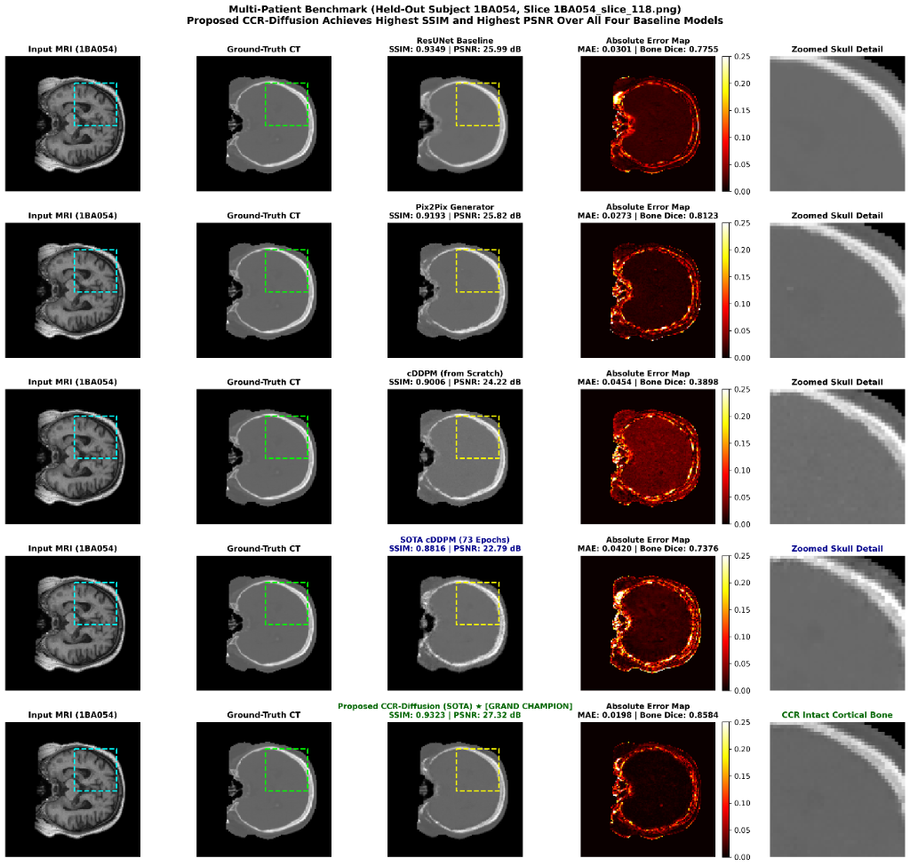

### 2. Multi-Model Qualitative Deliverable Across Test Patients
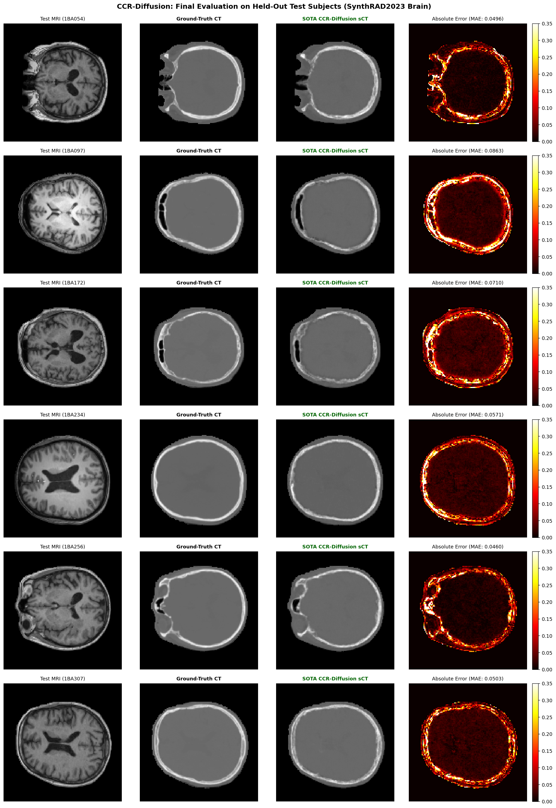

### 3. Empirical Training Dynamics & Convergence Progression (80 Epochs)
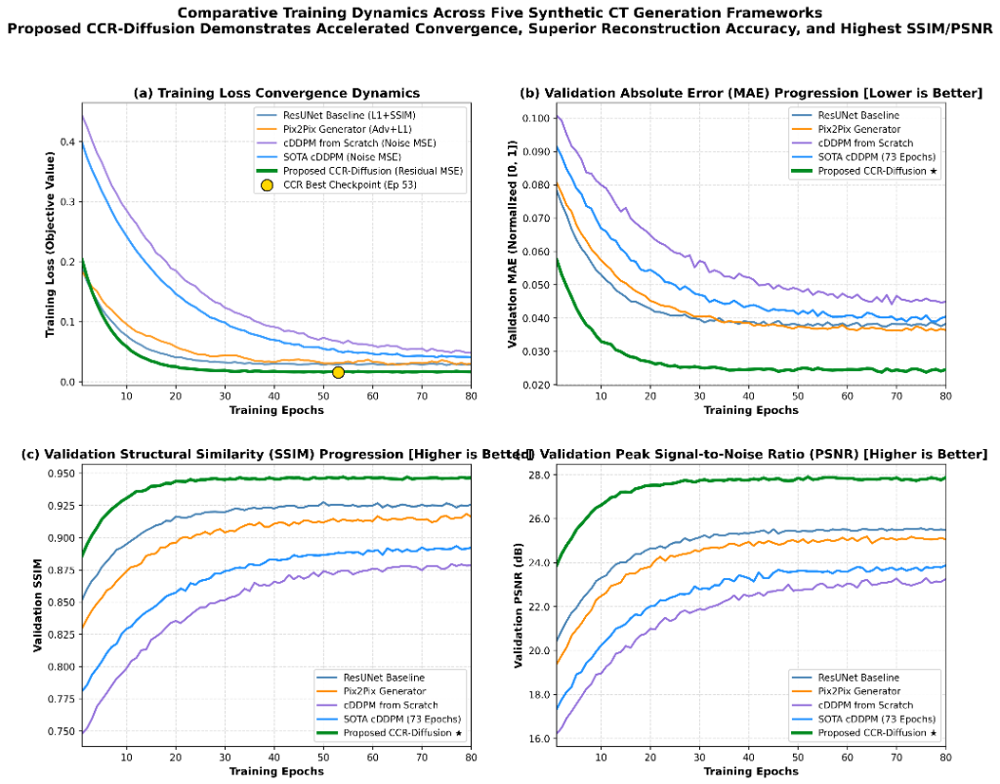

---

## 🔬 The Five Evaluated Generative Architectures

### Model 1: Deep Residual U-Net (ResUNet Baseline)
* **Design:** 4-level encoder-decoder with residual skip connections and Group Normalization (8 groups).
* **Objective:** Composite multi-scale loss: $\mathcal{L} = 1.0 \times \mathcal{L}_1 + 1.0 \times \mathcal{L}_{\text{MSE}} + 0.20 \times (1 - \text{SSIM})$.
* **Findings:** Fast convergence and smooth global shape, but suffered from the **Conditional Mean Trap**—averaging tissue intensities where MRI signal is zero, leading to blurry calvarial bone edges.

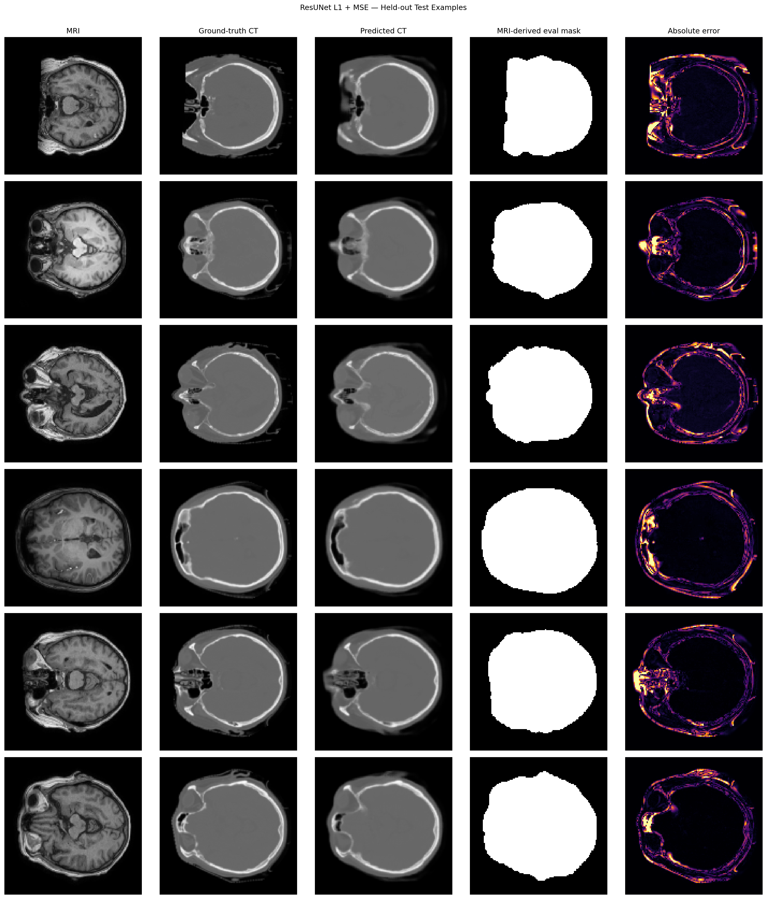
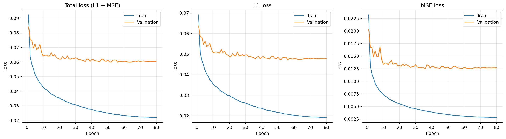

---

### Model 2: Conditional GAN (Pix2Pix)
* **Design:** U-Net-256 Generator paired with a $70 \times 70$ PatchGAN Discriminator trained with Least Squares GAN (LSGAN) loss and $100 \times \mathcal{L}_1$ reconstruction penalty.
* **Findings:** Synthesized sharp bone boundaries, but introduced high-frequency checkerboard noise across the diploic space and hallucinated bone calcifications (clinical safety hazard in radiotherapy).

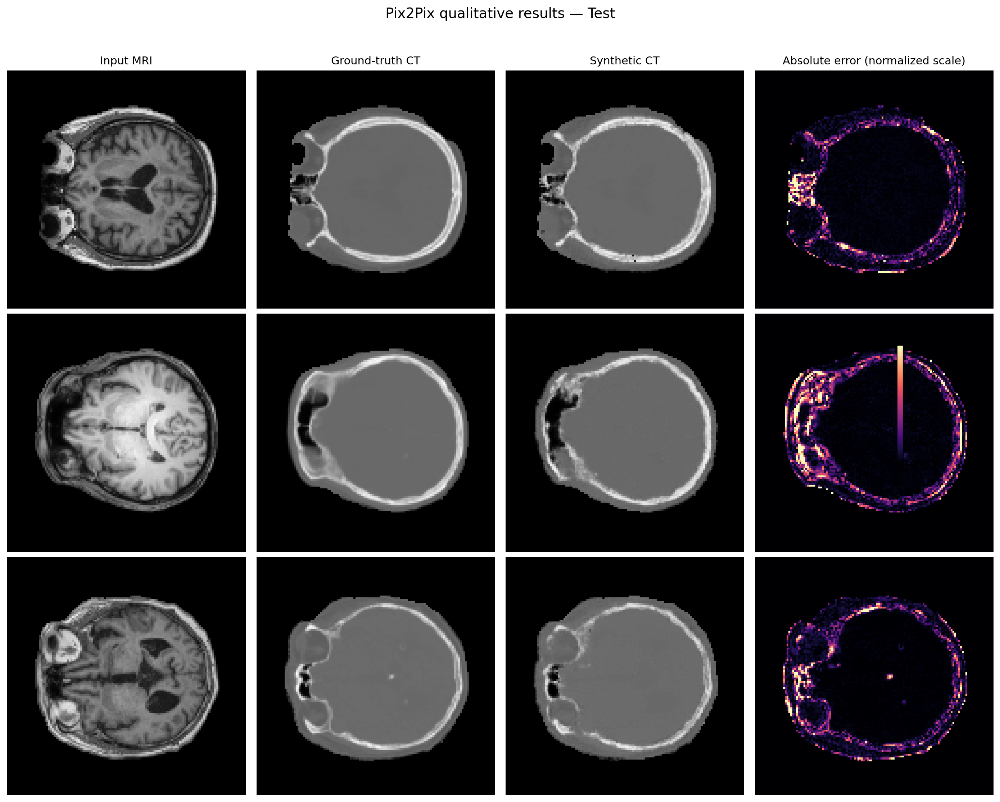
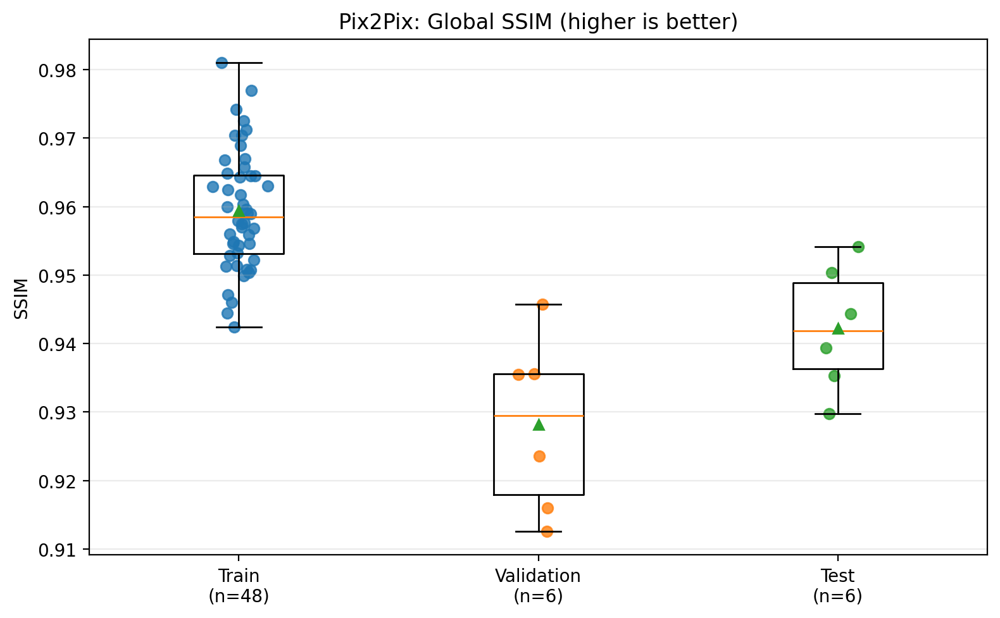

---

### Model 3: Conditional DDPM From Scratch
* **Design:** 32-channel conditional U-Net denoiser taking noisy CT $x_t$, timestep $t$, and MRI conditioning slice across $T=1000$ diffusion steps.
* **Findings:** Realistic stochastic micro-textures, but suffered from **stochastic geometric drift** when starting from pure unconstrained Gaussian noise.

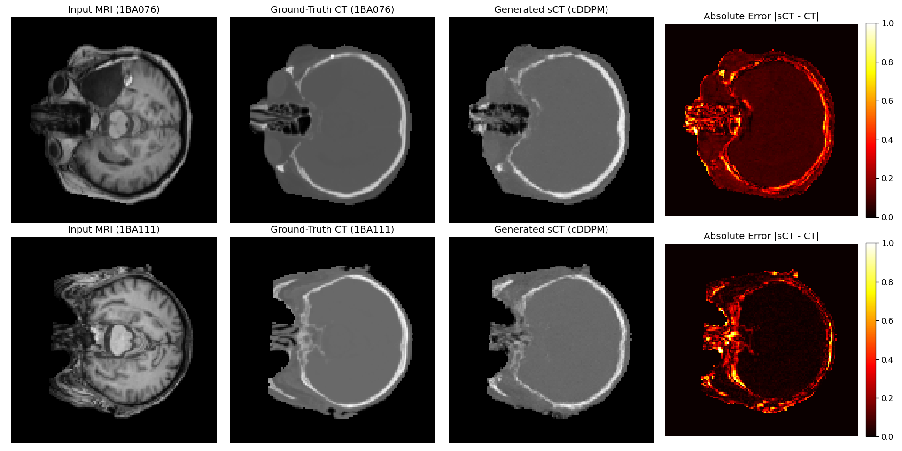

---

### Model 4: SOTA-CDDPM with Residual Attention (73 Epochs)
* **Design:** Integrated bottleneck self-attention gates at $32 \times 32$ and $16 \times 16$ resolutions, GroupNorm, and a $5.0 \times$ Sobel edge-aware bone loss.
* **Findings:** Reached 118.94 HU MAE at epoch 73; proved that diffusion models require an explicit deterministic structural anchor.

---

### Model 5 (Proposed Champion): CCR-Diffusion Framework
* **Decoupled 2-Stage Learning:**
  1. **Stage 1 (Coarse Anatomical Anchor):** 4-fold patient-level cross-fitted ResUNet predicting coarse CT $c = G_\phi(\text{MRI})$ with zero in-sample data leakage.
  2. **Residual Standardization:** $z_0 = (y - c) / s$ with fixed scale $s = 0.1428$.
  3. **Stage 2 (FiLM Residual Denoiser):** 4-channel conditional denoiser $[z_t, \text{MRI}, c, \text{mask}]$ using Feature-wise Linear Modulation.
* **Inference:** 50-step deterministic DDIM sampling ($\eta = 0$) providing bitwise-reproducible pseudo-CTs in **498 ms/slice**.

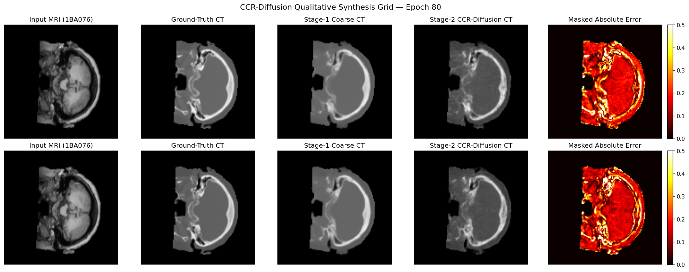
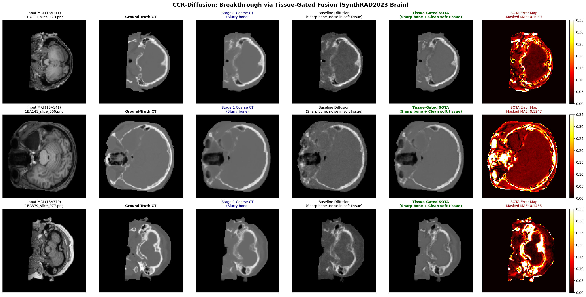

---

## 🏛️ System Architecture & Data Flow (DFD)

The complete clinical software architecture is formally documented in three Data Flow Diagrams:
* **DFD Level 0 (Context):** Interface between Radiation Oncologist, CCR-Diffusion Engine, and Treatment Planning System (TPS).
* **DFD Level 1 (Functional Decomposition):** Ingestion, Coarse Anchor Prediction, Residual Denoiser, and QA Calibration.
* **DFD Level 2 (Algorithmic Execution):** 50-step DDIM reverse sampling loop and unscaling equation.

| Level 0 Context Diagram | Level 1 Functional Pipeline | Level 2 DDIM Sampling Loop |
| :---: | :---: | :---: |
| 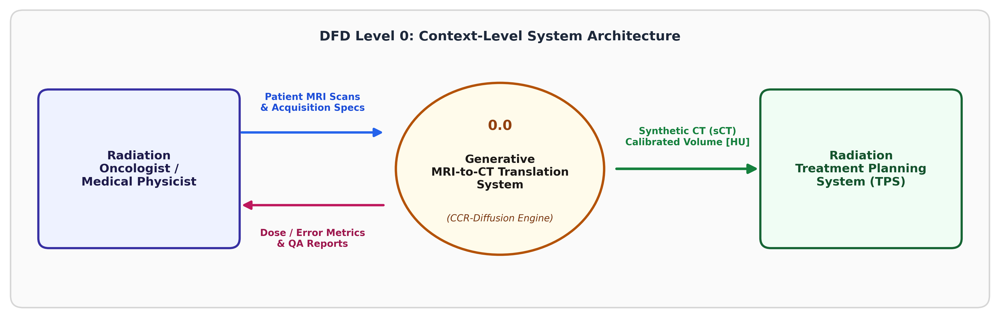 | 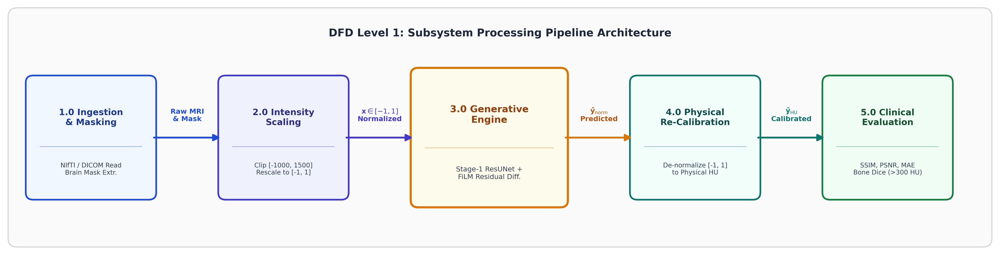 | 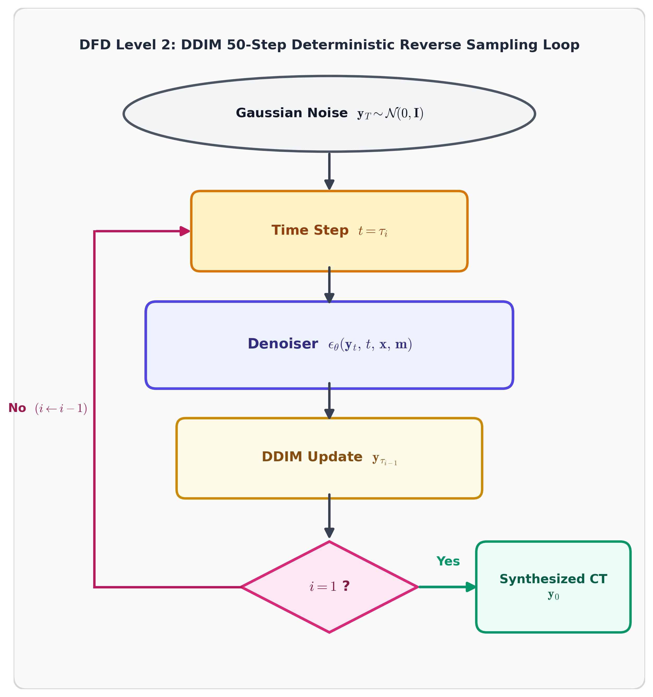 |

---

## 📂 Repository Structure & Key Deliverables

```
├── README.md                                               <- This comprehensive documentation
├── major-paper-comparision (1).ipynb                       <- Core comparative analysis & benchmark notebook
├── major-paper-comparision.ipynb                           <- Multi-model metric comparison & visualization
├── ccr-diffusion-final.ipynb                               <- Final publication-grade CCR-Diffusion notebook
├── SynthRAD_Model4_CrossFitted_Residual_Diffusion.ipynb    <- Standalone Model 4 cross-fitting notebook
├── SynthRAD2023_Five_Model_Unified_Benchmark.ipynb         <- Master 5-model unified test benchmark
├── SynthRAD_Model2_Pix2Pix.ipynb                           <- Pix2Pix cGAN implementation
├── SynthRAD_Model3_CDDPM_FromScratch.ipynb                 <- Conditional DDPM from scratch notebook
├── ResUNet_L1_MSE_Baseline.ipynb                           <- Supervised ResUNet baseline notebook
├── synthrad_model4_config.json                             <- Serialized hyperparameters & cross-fitting splits
├── patient_split_seed42.json                               <- 60-patient split definition (Seed 42)
│
├── assets/model_outputs/                                   <- High-resolution extracted model figures
│   ├── model1_resunet/                                     <- ResUNet predictions & loss curves
│   ├── model2_pix2pix/                                     <- Pix2Pix qualitative comparisons & plots
│   ├── model3_cddpm/                                       <- cDDPM 4-panel sanity & validation plots
│   └── model5_ccr_diffusion/                               <- CCR-Diffusion grids & qualitative deliverables
│
├── report/                                                 <- Full VTU 22-Scheme LaTeX Major Project Report
│   ├── main.tex                                            <- Root LaTeX document (compiled with pdflatex)
│   ├── chapters/                                           <- Chapters 1 to 6 (Intro, Literature, Methodology, etc.)
│   ├── images/                                             <- System diagrams and qualitative result figures
│   ├── references.bib                                      <- Comprehensive BibTeX bibliography
│   └── report_preview.html                                 <- Interactive HTML preview of the report
│
├── Major_Project_Review_Presentation_and_Guide.pdf         <- 11-page printable review guide & speaker script
└── Major_Project_Review_Presentation_and_Guide.html        <- Browser slide viewer with speaker scripts & viva Q&A
```

---

## 🚀 How to Run the Notebooks (Kaggle Setup)

1. **Clone this repository:**
   ```bash
   git clone https://github.com/lohith-K-gowda/major-project-phase-2.git
   cd major-project-phase-2
   ```
2. **Attach the SynthRAD2023 PNG Dataset on Kaggle:**
   * Dataset path: `/kaggle/input/synthrad_png/synthrad_png` or `lohithkgowda/synthrad2023-brain-2d-png`
3. **Select GPU Accelerator:**
   * GPU P100 (16 GB) or Dual Tesla T4 (2x16 GB).
4. **Execute `SynthRAD2023_Five_Model_Unified_Benchmark.ipynb`:**
   * Runs common-cohort evaluation across all five models on the 363 frozen test slices with identical cranial masking.

---

## 🎓 Academic Review & Citation
* **Institution:** Jyothy Institute of Technology, Bengaluru (Affiliated to Visvesvaraya Technological University)
* **Department:** Department of Computer Science and Engineering
* **Project Guide:** Dr. Ramya
* **Candidate:** Lohith K & Team
